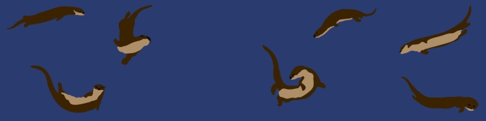

# Naki De Sousa Neves 🦦

🏊 Focusing on 42 Porto projects\
🦾 Interested in buiding embedded software to be used for 3D prosthetics\
🧠 Love learning about mental health and neurodiversity\
📳 Connect with me on [LinkedIn](https://www.linkedin.com/in/nakidesousaneves/)

### ♉🇵🇹🇿🇦🎮🃏🪄🧶🪡🎭🎨🎧🎸🧬🦦🐕🐾🌃⛰️🧗🌈🌊❄️

## Projects

| Project | Description | Tools |
| ------- | ----------- | ---------- |
| [A-Maze-ing](https://github.com/naki7/A-maze-ing) | Maze generator using Wilson's algorithm to create paths | Python, MLX, Virtual Environments, Linux  |
| [Codexion](https://github.com/naki7/Codexion) | C based Multi-Threading program that attemps to keep aliveness through starvation prevention techniques | C, Process Scheduling, Coffman's conditions, Starvation Prevention, Linux  |
| [Fly-in](https://github.com/naki7/Fly-in) | Drone pathfinding through maps based on cost and priority constraints | Python, Pathfinding, A* Algorithm, Dijkstra's Algorithm, Pygame, Parsing, Error Handling, Linux  |
| [Call Me Maybe](https://github.com/naki7/Call-Me-Maybe) | Constrained Decoded program that runs prompts through an LLM to get Function Calls | Python, LLM, Qwen, JSON, Logits, Tokens & Token IDs, LLM Vocab decoding & encoding, Parsing, Error Handling, Linux  |
